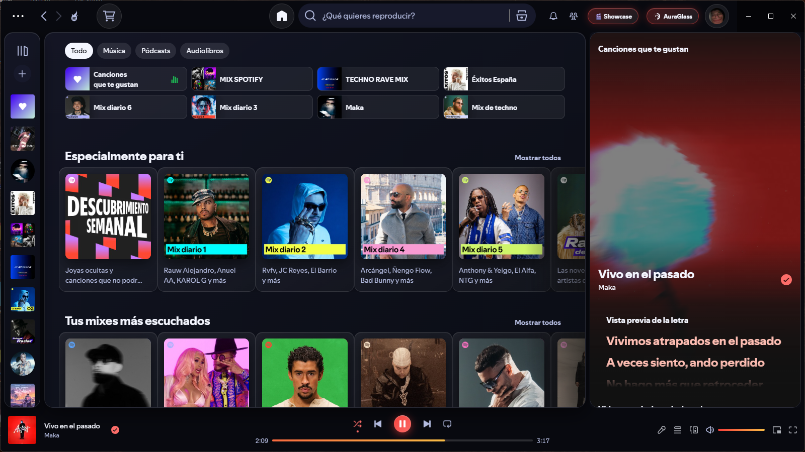

# ✨ AuraGlass — Spicetify Glassmorphism Theme

**AuraGlass** transforms Spotify into a modern **Apple Music / VisionOS Frosted Glass** experience with a live breathing album-art backdrop, automatic song color extraction, Apple Music style blurred lyrics, a fullscreen LP Vinyl Showcase mode, and an integrated **AuraGlass Studio** control panel.



---

## 🌟 Key Features

- **🪟 True Frosted Glass UI**: Translucent glass panels with specular 1px borders (`user.css`) engineered to keep Spotify's native tooltips 100% functional.
- **🌊 Live Breathing Album Backdrop**: Dual-layer crossfading cover art background with an animated aurora mesh.
- **🎨 Dynamic Song Palette + 4 Presets + Custom Color Picker**: Automatically extracts the most vibrant color from the current song's cover art, or choose between `AuraGlass`, `FrostCyan`, `RoseQuartz`, `EmeraldMist`, or any custom hex color in real time.
- **🎤 Apple Music Style Lyrics**: Out-of-focus inactive lyrics that smoothly unblur, scale up, and glow in sync with the active verse.
- **🎬 Fullscreen Vinyl Showcase (`Alt + S`)**: Turns Spotify into a living-room screensaver with a spinning LP vinyl record (complete with concentric grooves), live clock, synchronized lyrics, and an interactive neon progress bar.
- **📊 Mini Neon Equalizer & VisionOS Card Spotlight**: 4-bar animated equalizer next to the current track title and mouse-tracking radial light on cards.
- **✨ Built-in AuraGlass Studio**: Customize blur, brightness, glass opacity, borders, fonts, and a built-in **Sleep Timer** directly from the top bar without editing code.

---

## 📦 Installation

### Via Spicetify Marketplace
1. Open **Spotify** and go to **Marketplace** → **Themes**.
2. Search for **AuraGlass** and click **Install**.

### Manual Installation
1. Copy the `AuraGlass` folder into your Spicetify `Themes` directory:
   - **Windows**: `%appdata%\spicetify\Themes\AuraGlass`
   - **Linux / macOS**: `~/.config/spicetify/Themes/AuraGlass`
2. Run the following commands in your terminal:
   ```powershell
   spicetify config current_theme AuraGlass color_scheme AuraGlass inject_css 1 replace_colors 1 inject_theme_js 1
   spicetify apply
   ```
